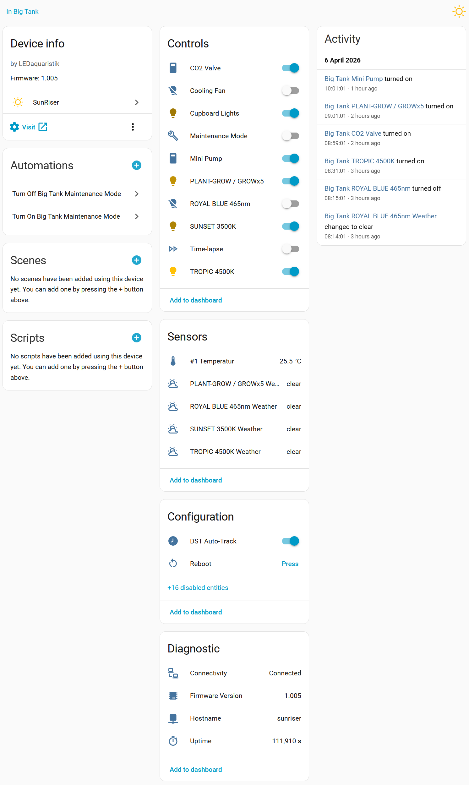

# Installation

## Requirements

- Home Assistant 2026.11 or newer, which includes the Marketplace
- SunRiser 8 or 10 reachable from Home Assistant on your local network
- Controller firmware 1.006 for the current release; compatibility with older firmware is unverified.

## Install from the Marketplace

1. Go to **Settings > Marketplace**
2. Search for **SunRiser** and open its page
3. Select **Install**; Home Assistant opens the SunRiser setup straight away

Updates appear under **Settings > Updates**. After an update, restart Home Assistant and refresh the dashboard to load the current Day Planner card.

## Set up the integration

1. Go to **Settings -> Devices & Services -> Add Integration**
2. Search for **SunRiser**
3. Enter your device's IP address or hostname (for example, `sunriser`, if it resolves on your network)
4. Enter the port if you changed it from the default (default: `{{ cfg.default_port }}`)
5. Click **Submit**

The integration will automatically detect all active PWM channels and temperature sensors on your device.

*Earlier firmware 1.005 example; current releases include additional controls and firmware 1.006 handles DST itself.*

!!! note
    Entities are created during setup after state and configuration have loaded. Home Assistant retries setup if required reads fail.

## Automatic discovery

The integration can discover SunRiser devices automatically via DHCP. When a device with a hostname matching `sunriser*` joins your network, Home Assistant will prompt you to set it up. You can also initiate setup manually via **Settings -> Devices & Services -> Add Integration -> SunRiser**.

## Update the host or port

If your device's IP address changes, go to **Settings -> Devices & Services -> SunRiser -> three-dot menu -> Reconfigure**. You can update the host and port without removing the integration - all automations and entity history are preserved.

## Remove the integration

1. Go to **Settings -> Devices & Services**
2. Find the **SunRiser** integration and click the three-dot menu
3. Select **Delete**
4. In **Settings > Marketplace**, open the **Installed** tab and uninstall **SunRiser**
5. Restart Home Assistant
